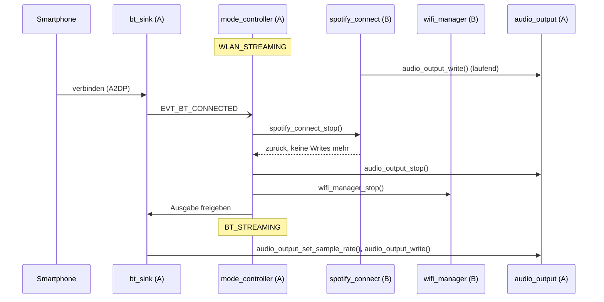

# Schnittstelle zwischen Bluetooth-Zweig (Person A) und WLAN-Zweig (Person B)

Dieses Dokument legt fest, wie die beiden Zweige miteinander reden. Solange sich beide an diese Regeln halten, kann jede Person ihren Teil unabhängig bauen und testen. Änderungen an diesem Vertrag nur per gemeinsamem Pull Request.

Zustände und Use Cases: [`uml/uml.md`](uml/uml.md)

---

## 1. Überblick

Es gibt genau **drei Berührungspunkte**:

| # | Verbindung | Richtung | Header |
|---|------------|----------|--------|
| 1 | **Audio:** WLAN-Zweig gibt Spotify-Audio über die Audioausgabe von A aus | B → A | `audio_output.h` |
| 2 | **Steuerung:** Der Zustandsautomat von A schaltet WLAN und Spotify Connect ein und aus | A → B | `wifi_manager.h`, `spotify_connect.h` |
| 3 | **Ereignisse:** Der WLAN-Zweig meldet, was passiert ist | B → A | `app_events.h` (Callback) |

```mermaid
flowchart LR
    subgraph A["Person A"]
        BT[bt_sink]
        MC[mode_controller]
        AO[audio_output]
    end
    subgraph B["Person B"]
        WM[wifi_manager]
        SC[spotify_connect]
    end

    MC -->|"② start() / stop()"| WM
    MC -->|"② start() / stop()"| SC
    WM -.->|"③ Ereignis per Callback"| MC
    SC -.->|"③ Ereignis per Callback"| MC
    SC -->|"① audio_output_write()"| AO
    BT -->|audio_output_write()| AO
    BT -.->|Ereignis per Callback| MC
```

**Wichtig:** Die Komponenten von Person B binden `mode_controller.h` nicht ein. Sie bekommen in `init()` eine Callback-Funktion übergeben und melden darüber. `main.cpp` verbindet beides. So gibt es keine gegenseitige Abhängigkeit.

---

## 2. Die Header

| Header | Ort | Owner | Inhalt |
|--------|-----|-------|--------|
| `app_events.h` | `lib/config/` | gemeinsam | alle Ereignisse, Callback-Typ `app_event_cb_t` |
| `audio_output.h` | `lib/audio_output/include/` | A | PCM ausgeben, Abtastrate, Lautstärke |
| `wifi_manager.h` | `lib/wifi_manager/include/` | B | WLAN starten, stoppen, Status |
| `spotify_connect.h` | `lib/spotify_connect/include/` | B | Spotify Connect starten, stoppen, Status |
| `mode_controller.h` | `lib/mode_controller/include/` | A | Zustände, `post()`, `update()` |

Die genaue Bedeutung jeder Funktion steht als Kommentar im Header.

---

## 3. Regeln

### Audio (①)

- **Format:** 16 Bit signed, little endian, Stereo verschachtelt (L, R, L, R …). Abtastrate 44 100 oder 48 000 Hz.
- Jede Quelle ruft `audio_output_set_sample_rate()` auf, bevor sie die ersten Daten schreibt.
- `audio_output_write()` darf aus dem Audio-Task der Quelle aufgerufen werden und blockiert höchstens ca. 50 ms.
- **Es schreibt immer nur eine Quelle.** Der `mode_controller` stoppt die alte Quelle, bevor die neue Daten ausgeben darf. `bt_sink` verwirft Audiodaten, bis der `mode_controller` ihn freigibt.
- **Lautstärke** immer in Prozent (0–100) über `audio_output_set_volume()`. Spotify (0–65535) und Bluetooth (0–127) rechnen vorher selbst um.

### Steuerung (②)

- `start()` kehrt sofort zurück; das Ergebnis kommt später als Ereignis.
- `stop()` kehrt erst zurück, wenn die Komponente wirklich still ist:
  - `wifi_manager_stop()`: Funk aus, höchstens 500 ms.
  - `spotify_connect_stop()`: garantiert keine weiteren `audio_output_write()`-Aufrufe, höchstens 1 s.
- Nach `stop()` meldet die Komponente keine Ereignisse mehr bis zum nächsten `start()`.
- `start()` und `stop()` ruft nur der `mode_controller` auf, und zwar aus `loop()`.
- `wifi_manager` verbindet sich nach einem Verlust **nicht** selbst neu; das entscheidet der `mode_controller`.

### Ereignisse (③)

- Der Callback darf aus jedem Task aufgerufen werden und blockiert nicht.
- Im Callback nur das Ereignis melden, keine weitere Arbeit.
- Pause in der Spotify-App erzeugt kein Ereignis. `EVT_SPOTIFY_PLAYBACK_STARTED` heißt „Adapter ist aktives Gerät und spielt“, `EVT_SPOTIFY_PLAYBACK_STOPPED` heißt „anderes Gerät gewählt oder Sitzung beendet“.
- Ereignisse, die im aktuellen Zustand keinen Sinn ergeben (z. B. ein verspätetes WLAN-Ereignis nach `stop()`), ignoriert der `mode_controller`.

### Zeiten

| Wert | Wo festgelegt | Zuständig |
|------|---------------|-----------|
| WLAN-Verbindungs-Timeout 15 s | `WIFI_CONNECT_TIMEOUT_MS` in `wifi_manager.h` | B |
| Neuer WLAN-Versuch nach 60 s in IDLE | `mode_controller` | A |

---

## 4. Zustandsübergänge im Detail

Was der `mode_controller` bei welchem Ereignis aufruft. Das ist die Vorlage für die Implementierung und für die Unit-Tests von `mode_fsm`.

| Zustand | Ereignis | Aufrufe | Neuer Zustand |
|---------|----------|---------|---------------|
| BOOT | Init erfolgreich | `bt_sink_start()`, `wifi_manager_start()` | WLAN_VERBINDEN |
| WLAN_VERBINDEN | `EVT_WIFI_CONNECTED` | `spotify_connect_start()` | WLAN_BEREIT |
| WLAN_VERBINDEN | `EVT_WIFI_CONNECT_FAILED` | Retry-Timer 60 s starten | IDLE |
| IDLE | `EVT_RETRY_TIMER` | `wifi_manager_start()` | WLAN_VERBINDEN |
| WLAN_BEREIT | `EVT_SPOTIFY_PLAYBACK_STARTED` | – | WLAN_STREAMING |
| WLAN_STREAMING | `EVT_SPOTIFY_PLAYBACK_STOPPED` | `audio_output_stop()` | WLAN_BEREIT |
| WLAN_BEREIT, WLAN_STREAMING | `EVT_WIFI_LOST` | `spotify_connect_stop()`, `audio_output_stop()`, `wifi_manager_start()` | WLAN_VERBINDEN |
| WLAN_VERBINDEN, WLAN_BEREIT, WLAN_STREAMING, IDLE | `EVT_BT_CONNECTED` | Retry-Timer stoppen, `spotify_connect_stop()`, `audio_output_stop()`, `wifi_manager_stop()`, Bluetooth-Ausgabe freigeben | BT_STREAMING |
| BT_STREAMING | `EVT_BT_DISCONNECTED` | Bluetooth-Ausgabe sperren, `audio_output_stop()`, `wifi_manager_start()` | WLAN_VERBINDEN |
| alle | alle anderen | ignorieren | unverändert |

### Beispiel: Bluetooth übernimmt während Spotify läuft



---

## 5. Unabhängig entwickeln

| Person | Braucht von der anderen | Bis es fertig ist |
|--------|-------------------------|-------------------|
| B testet Spotify Connect | `audio_output` | A liefert `audio_output` als **ersten Meilenstein**. Bis dahin eine Test-Version, die nur die geschriebenen Bytes zählt und auf der seriellen Konsole ausgibt. |
| A testet den Zustandsautomaten | Ereignisse von `wifi_manager` und `spotify_connect` | Unit-Tests am PC mit erfundenen Ereignissen; auf dem Board Ereignisse per serieller Eingabe auslösen. |
| beide | `main.cpp` | einmal gemeinsam anlegen (siehe unten), danach kaum ändern |

### Verdrahtung in `main.cpp`

```cpp
#include <Arduino.h>
#include "audio_output.h"
#include "bt_sink.h"
#include "wifi_manager.h"
#include "spotify_connect.h"
#include "mode_controller.h"

void setup() {
    Serial.begin(115200);
    audio_output_init();                        // A
    bt_sink_init(mode_controller_post);         // A
    wifi_manager_init(mode_controller_post);    // B
    spotify_connect_init(mode_controller_post); // B
    mode_controller_init();                     // A, zuletzt
}

void loop() {
    mode_controller_update();
    delay(5);
}
```
