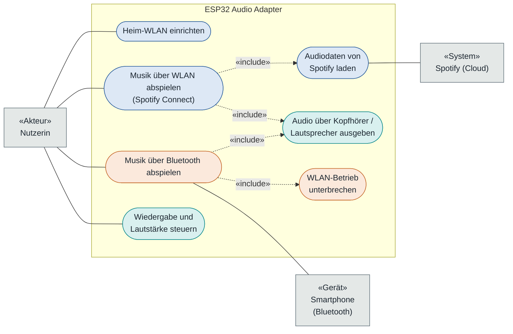
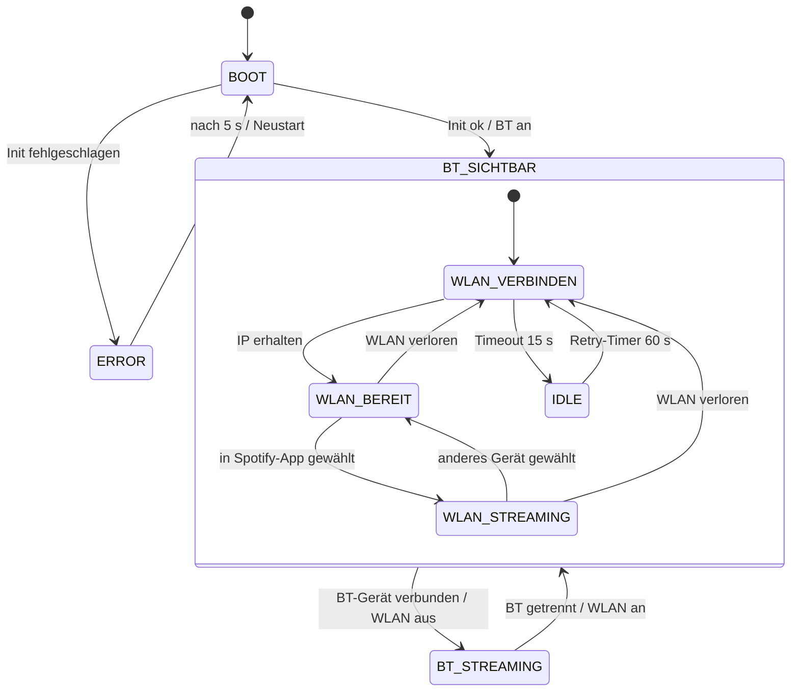
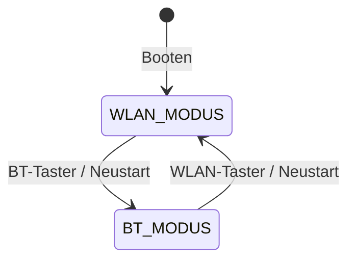

# ESP32 Audio Adapter – UML-Beschreibung

Software-Engineering-Projekt, Elektrotechnik B.Sc., Semester 6
Hardware: AI-Thinker ESP32 Audio Kit (ESP32-A1S, Codec ES8388) · Framework: PlatformIO

---

## 1. Projektbeschreibung

Der Adapter macht analoge Kopfhörer und Lautsprecher (mit Verstärker) kabellos. Musik kommt auf zwei Wegen:

- **WLAN (Standard):** Der Adapter verbindet sich nach dem Einschalten mit dem Heim-WLAN und erscheint in der Spotify-App als Wiedergabegerät (Spotify Connect). Wählt die Nutzerin ihn dort aus, lädt der ESP32 die Audiodaten selbst aus dem Internet und gibt sie über den Codec aus. Das Smartphone ist dabei nur Fernbedienung.
- **Bluetooth:** Der Adapter ist jederzeit als Bluetooth-Lautsprecher sichtbar. Verbindet sich ein Smartphone, hat Bluetooth Vorrang: Die WLAN-Wiedergabe endet, WLAN wird abgeschaltet, und der Adapter spielt nur noch das Audio vom Smartphone. Nach dem Trennen verbindet er sich wieder mit dem WLAN.

Die Nutzerin entscheidet also selbst, welchen Weg sie nimmt: Adapter in der Spotify-App auswählen (WLAN) oder Smartphone per Bluetooth verbinden.

### User Story

> **Als** Musikhörerin **möchte ich** meine vorhandenen Kopfhörer oder Lautsprecher an einen kleinen Adapter anschließen und darauf Musik entweder über mein Heim-WLAN mit Spotify oder direkt per Bluetooth von meinem Smartphone abspielen, **damit** ich meine Audiogeräte kabellos nutzen kann, ohne neue Geräte zu kaufen.

| ID | Teil-Story | Akzeptanzkriterien |
|----|------------|--------------------|
| US-1 | Als Nutzerin möchte ich den Adapter in der Spotify-App als Gerät auswählen, wenn ich im selben WLAN bin, damit die Musik direkt aus dem Internet kommt und mein Handy nicht zuspielen muss. | Nach dem Einschalten verbindet sich der Adapter ohne Zutun mit dem Heim-WLAN. Er erscheint in der Spotify-App als „ESP32 Audio Adapter“. Play, Pause, Skip und Lautstärke aus der App wirken auf den Adapter. |
| US-2 | Als Nutzerin möchte ich mein Smartphone jederzeit per Bluetooth verbinden können, auch wenn der Adapter gerade im WLAN läuft, damit ich auch ohne Spotify Musik hören kann. | Der Adapter ist immer per Bluetooth sichtbar, außer während einer Bluetooth-Verbindung. Beim Verbinden endet die WLAN-Wiedergabe und das Audio kommt vom Smartphone. Nach dem Trennen verbindet er sich wieder mit dem WLAN. |
| US-3 | Als Nutzerin möchte ich, dass der Adapter auch ohne WLAN nutzbar bleibt, damit ein Router-Ausfall mich nicht stört. | Ohne WLAN wartet der Adapter in IDLE, Bluetooth funktioniert weiter, und er versucht es alle 60 s erneut mit dem WLAN. |

**Rahmenbedingungen:** Spotify Connect auf dem ESP32 funktioniert nur mit Spotify Premium. Die Spotify-Web-API liefert selbst keine Audiodaten; dafür ist Spotify Connect nötig (siehe Abschnitt 3, Machbarkeit).

---

## 2. Use-Case-Diagramm

| Use Case | Beschreibung | Story |
|----------|--------------|-------|
| Heim-WLAN einrichten | Zugangsdaten einmalig hinterlegen; danach verbindet sich der Adapter beim Einschalten selbst. | US-1, US-3 |
| Musik über WLAN abspielen | Nutzerin wählt den Adapter in der Spotify-App. Der Adapter lädt die Audiodaten selbst (enthält „Audiodaten von Spotify laden“ und „Audio ausgeben“). | US-1 |
| Musik über Bluetooth abspielen | Smartphone verbindet sich per A2DP. Hat Vorrang und unterbricht den WLAN-Betrieb (enthält „WLAN-Betrieb unterbrechen“ und „Audio ausgeben“). | US-2 |
| Wiedergabe und Lautstärke steuern | Im WLAN-Betrieb über die Spotify-App, im Bluetooth-Betrieb über das Smartphone. | US-1, US-2 |

Farben: blau = WLAN-Zweig (Person B), orange = Bluetooth-Zweig (Person A), türkis = gemeinsam.

---

## 3. Betriebsmodi und Zustandsautomat (FSM)

### Betriebsmodi

| Modus | Audioquelle | WLAN | Bluetooth sichtbar |
|-------|-------------|------|--------------------|
| WLAN-Betrieb (Standard) | Spotify über WLAN (Spotify Connect) | an | ja |
| IDLE | keine | Verbindungsversuch alle 60 s | ja |
| Bluetooth-Betrieb | Smartphone per A2DP | aus | nein (verbunden) |

### Zustandsautomat

| Zustand | Was passiert |
|---------|--------------|
| BOOT | Codec, Bluetooth und WLAN initialisieren. |
| ERROR | Fehler loggen, nach 5 s Neustart. |
| BT_SICHTBAR | Zusammengesetzter Zustand: Bluetooth ist sichtbar und verbindbar, egal welcher innere Zustand aktiv ist. |
| WLAN_VERBINDEN | Mit dem Heim-WLAN verbinden (max. 15 s). |
| WLAN_BEREIT | Im WLAN, in der Spotify-App als Gerät sichtbar, keine Wiedergabe. |
| WLAN_STREAMING | Audiodaten von Spotify laden und über den Codec ausgeben. |
| IDLE | Kein WLAN. Wartet, Retry-Timer läuft. |
| BT_STREAMING | WLAN aus, Audio vom Smartphone über den Codec ausgeben. |

Der Übergang vom Rand von `BT_SICHTBAR` nach `BT_STREAMING` gilt für alle inneren Zustände: Eine Bluetooth-Verbindung hat immer Vorrang, auch während WLAN-Wiedergabe. Nach dem Trennen beginnt der Ablauf wieder bei `WLAN_VERBINDEN`. Timeout und Retry-Zeit sind Vorschläge.

### Machbarkeit und Rückfallebene

- **WLAN und Bluetooth gleichzeitig:** Der ESP32 kann beides parallel betreiben. Gestreamt wird aber nie über beide gleichzeitig, weil WLAN beim Bluetooth-Verbinden abgeschaltet wird.
- **Spotify-Audio über WLAN (größtes Risiko):** Dafür muss der ESP32 ein Spotify-Connect-Gerät sein. Die Bibliothek dafür ist [cspot](https://github.com/feelfreelinux/cspot). Sie ist für ESP-IDF gebaut, ihr nutzt Arduino. Mögliche Wege: in PlatformIO `framework = arduino, espidf` (Arduino als ESP-IDF-Komponente) oder das Projekt auf ESP-IDF umstellen. cspot braucht praktisch PSRAM, den das ESP32-A1S-Modul hat; er muss aktiviert werden.
- **Machbarkeitstest zuerst (ca. 2 h, gemeinsam):** cspot auf dem Board zum Laufen bringen, einen Song abspielen, dann zusätzlich den Bluetooth-Sink sichtbar starten und 10 Minuten ohne Neustart oder Aussetzer laufen lassen. Freien Speicher mit `ESP.getFreeHeap()` beobachten.
- **Wenn Bluetooth-Vorrang nicht stabil läuft:** Umschalten per Taster. Beim Booten startet immer WLAN.

- **Wenn cspot nicht läuft:** WLAN-Audio als Internetradio mit der Bibliothek arduino-audio-tools. Das bleibt im Arduino-Framework; Spotify gibt es dann nur über Bluetooth.

---

## 4. Arbeitsteilung

| Paket | Inhalt | Owner | Std. |
|-------|--------|-------|-----:|
| Requirements und UML | dieses Dokument, GitHub-Issues | Gemeinsam | 3 |
| Architektur und Repo | Ordnerstruktur, `platformio.ini`, CI | Gemeinsam | 4 |
| Machbarkeitstest | cspot und Bluetooth gleichzeitig auf dem Board | Gemeinsam | 2 |
| Audioausgabe | `audio_output`: I2S, ES8388, Lautstärke | Person A | 4 |
| Bluetooth | `bt_sink`: A2DP-Sink, Verbindungs-Callback | Person A | 5 |
| Zustandsautomat | `mode_fsm`, `mode_controller`: FSM aus Abschnitt 3 | Person A | 3 |
| WLAN | `wifi_manager`: verbinden, Timeout, Retry, abschalten | Person B | 3 |
| Spotify Connect | `spotify_connect`: cspot einbinden, Audio an `audio_output` | Person B | 9 |
| Tests und Reviews | Unit-Tests für die FSM, Testprotokoll, Pull-Request-Reviews | Gemeinsam | 4 |
| Doku und Abschluss | README, Präsentation | Gemeinsam | 3 |
| **Summe** | | | **40** |

Je Person ca. 20 h: Person A 12 h eigene Pakete, Person B 12 h, plus je 8 h gemeinsame Pakete.

**Schnittstelle zwischen A und B:** Beide Zweige geben Audio über `audio_output_write()` aus und melden Ereignisse (verbunden, getrennt, Wiedergabe gestartet) per Callback an den `mode_controller`. Diese Header legt ihr zuerst gemeinsam fest, danach arbeitet jede Person in ihren eigenen Ordnern unter `lib/`.
